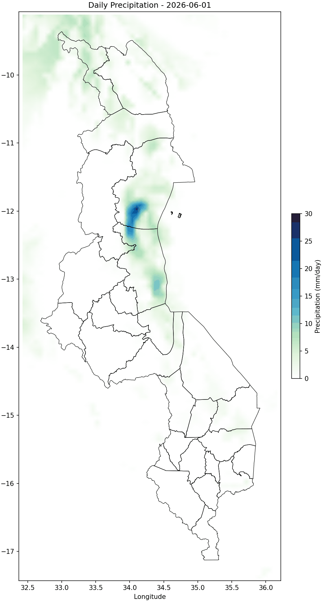
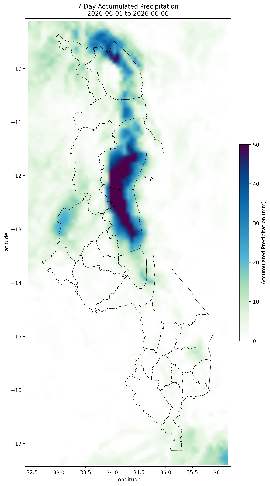
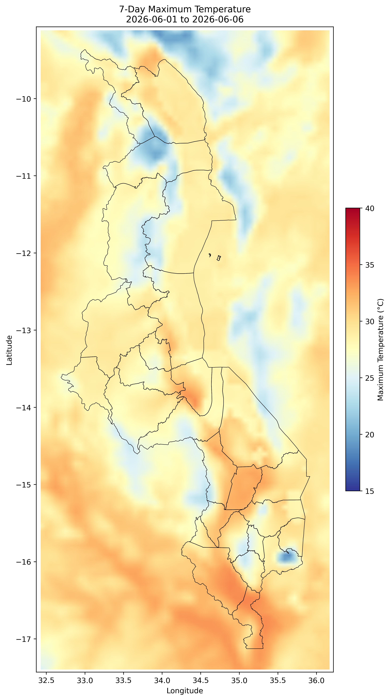

# WRF Post-Processing Pipeline

A Python script for operational post-processing of daily WRF model output. It extracts a forecast window from a NetCDF file, clips to a configurable domain bounding box, extracts values at met station locations via nearest-neighbour matching, and writes station CSVs, static maps, and a daily precipitation animation.

Written for NWP operational workflows at national meteorological services, but works for any WRF domain.

---

## Example outputs

Daily precipitation animation (one frame per forecast day):



<table>
  <tr>
    <td align="center"><b>Accumulated Precipitation</b></td>
    <td align="center"><b>Maximum Temperature</b></td>
  </tr>
  <tr>
    <td></td>
    <td></td>
  </tr>
</table>

## Outputs

All outputs go into a run-specific directory named `WRF_OUTPUT_<start>_<end>/`:

| File                           | Description                                                                        |
| ------------------------------ | ---------------------------------------------------------------------------------- |
| `wrf_stations_daily_*.csv`   | Long format — one row per station per day, all variables                          |
| `wrf_stations_summary_*.csv` | One row per station — period aggregates (total precip, peak temp, max wind)       |
| `wrf_stations_wide_*.csv`    | Wide format — daily columns per variable with summary columns appended            |
| `wrf_grid_*.csv`             | Flattened grid of period aggregates, for use in downstream R or Python map scripts |
| `map_precip_*.png`           | Accumulated precipitation map (400 dpi)                                            |
| `map_tmax_*.png`             | Maximum temperature map (400 dpi)                                                  |
| `anim_precip_daily_*.gif`    | Daily precipitation animation, one frame per forecast day                          |

---

## Setup

Python 3.9 or later.

```bash
pip install -r requirements.txt
```

You'll also need:

- An admin-level shapefile for your domain (see [Required files](#required-files))
- A station list in the format described below, or use `stations_example.csv` as a starting point

---

## Usage

**1. Place your WRF NetCDF file in the working directory.**

The file must match the glob pattern set by `NC_GLOB` in the configuration block (default: `wrf_daily_*.nc`). Exactly one match is expected — the script raises an error if it finds zero or more than one.

**2. Edit the configuration block** at the top of `wrf_postprocess.py`:

```python
FORECAST_START = "2026-06-01"   # start of your forecast window
FORECAST_END   = "2026-06-06"   # end of your forecast window

LAT_MIN = -17.43                # bounding box for your domain
LAT_MAX =  -9.07
LON_MIN =  32.37
LON_MAX =  36.22

STATIONS_FILE  = "stations.csv"
SHAPEFILE_PATH = "SHAPEFILE/admin.shp"
```

**3. Run:**

```bash
python wrf_postprocess.py
```

To skip a slow step on a resource-constrained machine:

```python
GENERATE_CSVS       = True
GENERATE_MAPS       = True
GENERATE_ANIMATION  = False   # skip GIF generation
```

---

## Required files

### Station list (`stations.csv`)

A CSV with one row per met station. Copy `stations_example.csv` to `stations.csv` and replace with your real station coordinates.

| Column      | Type   | Description                  |
| ----------- | ------ | ---------------------------- |
| `station` | string | Station name                 |
| `LAT`     | float  | Latitude in decimal degrees  |
| `LON`     | float  | Longitude in decimal degrees |

Rows with missing `LAT` or `LON` are dropped silently. Station coordinates outside the domain bounding box will match to the nearest grid point on the edge — check your station list against your domain if you get unexpected values.

Sources for station coordinate data:

- [WMO OSCAR/Surface](https://oscar.wmo.int/surface/) — global station registry
- Your national meteorological service's station catalogue

### Shapefile (`SHAPEFILE/admin.shp`)

An admin-boundary shapefile for map overlays. Any polygon shapefile covering your domain works. Place the full set of shapefile components (`.shp`, `.dbf`, `.shx`, `.prj`) in a `SHAPEFILE/` subdirectory and point `SHAPEFILE_PATH` to the `.shp` file.

For country-level admin boundaries, [GADM](https://gadm.org/download_country.html) provides free shapefiles at multiple admin levels.

### WRF NetCDF file

The script expects a single NetCDF file matching `NC_GLOB`. Required variables:

| Variable        | Description                        |
| --------------- | ---------------------------------- |
| `tp`          | Daily precipitation (mm)           |
| `tmax`        | Daily maximum 2m temperature (°C) |
| `tmin`        | Daily minimum 2m temperature (°C) |
| `wind10_mean` | Daily mean 10m wind speed (m/s)    |
| `wind10_max`  | Daily maximum 10m wind speed (m/s) |
| `lat`         | 2D latitude array                  |
| `lon`         | 2D longitude array                 |

The `time` coordinate must be parseable as dates (standard WRF output is; post-processed files sometimes need fixing with `cdo settaxis` or `xarray` encoding fixes before running).

---

## Bias flagging

If some stations in your domain are known to receive systematically biased WRF values (e.g. stations near large lakes or coastlines where land-surface interactions inflate precipitation), add their names to `BIAS_FLAGGED_STATIONS` in the configuration block:

```python
BIAS_FLAGGED_STATIONS = {
    "Station Name A",
    "Station Name B",
}
```

Flagged stations appear with `bias_flag = True` in the daily and summary CSVs. Their values are preserved — the flag is informational, not a filter.

---

## Configuration reference

| Parameter                        | Default                 | Description                                  |
| -------------------------------- | ----------------------- | -------------------------------------------- |
| `FORECAST_START`               | —                      | Forecast window start (`YYYY-MM-DD`)       |
| `FORECAST_END`                 | —                      | Forecast window end (`YYYY-MM-DD`)         |
| `GENERATE_CSVS`                | `True`                | Write CSV outputs                            |
| `GENERATE_MAPS`                | `True`                | Write static PNG maps                        |
| `GENERATE_ANIMATION`           | `True`                | Write daily GIF                              |
| `LAT_MIN/MAX`, `LON_MIN/MAX` | —                      | Domain bounding box                          |
| `STATIONS_FILE`                | `stations.csv`        | Path to station list                         |
| `SHAPEFILE_PATH`               | `SHAPEFILE/admin.shp` | Path to admin boundary shapefile             |
| `NC_GLOB`                      | `wrf_daily_*.nc`      | Glob pattern to locate the NetCDF file       |
| `BIAS_FLAGGED_STATIONS`        | `set()`               | Station names to flag in output CSVs         |
| `PRECIP_CAP_MM`                | `50`                  | Colorbar cap for accumulated precip map (mm) |
| `PRECIP_CAP_DAILY`             | `30`                  | Colorbar cap for animation frames (mm/day)   |
| `BOUNDARY_CELLS`               | `5`                   | Cells to discard on each WRF domain edge     |

---

## Notes

- A `BOUNDARY_CELLS`-cell inward mask is applied before clipping to remove lateral boundary artefacts from the WRF integration.
- Station extraction uses `scipy.spatial.cKDTree` — fast enough for networks of several hundred stations.
- Wind speed is written in both m/s (2 d.p.) and km/h (1 d.p.).
- The precipitation colormap follows the WMO bulletin standard palette (white → green → blue → purple). Edit `PRECIP_COLORS` to match your organisation's style guide.
- The temperature map uses `RdYlBu_r` with a fixed 15–40 °C range. Adjust `vmin`/`vmax` in `generate_maps()` if your domain has a different climatological range.

---

## Contributing

Bug reports and pull requests are welcome. If you adapt the script for a different WRF configuration or variable naming convention, please open an issue describing your setup so it can be documented.

---

## License

MIT
